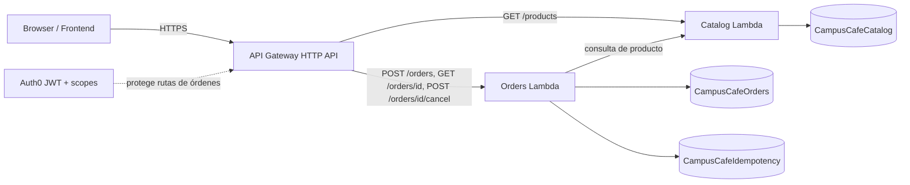

# Arquitectura

Campus Café usa una arquitectura serverless en AWS con dos funciones Java 17 y persistencia en DynamoDB.

## Componentes
- Frontend estático: `frontend/`.
- API Gateway HTTP API: expone el contrato HTTP.
- `CatalogFunction`: consulta el catálogo.
- `OrdersFunction`: crea, consulta y cancela órdenes.
- DynamoDB: `CampusCafeCatalog`, `CampusCafeOrders` y `CampusCafeIdempotency`.
- Auth0 JWT: valida identidad y scopes en las rutas protegidas.

## Flujo principal
1. El navegador consulta `GET /products`.
2. Para crear una orden, el cliente envía `POST /orders`, un Access Token y `Idempotency-Key`.
3. Orders valida el principal JWT (`iss`, `sub`), valida el cuerpo y consulta catálogo con un límite de tiempo.
4. DynamoDB guarda orden e idempotencia en una transacción condicional.
5. Un reintento idéntico recupera la respuesta original; reutilizar la clave con otro contenido produce conflicto.

## Diagrama

## Seguridad
Las rutas de órdenes requieren scopes `orders:create`, `orders:read` y `orders:cancel`. El backend obtiene propietario desde los claims verificados y no confía en un propietario enviado por el navegador. Las credenciales de AWS no deben residir en el frontend.
